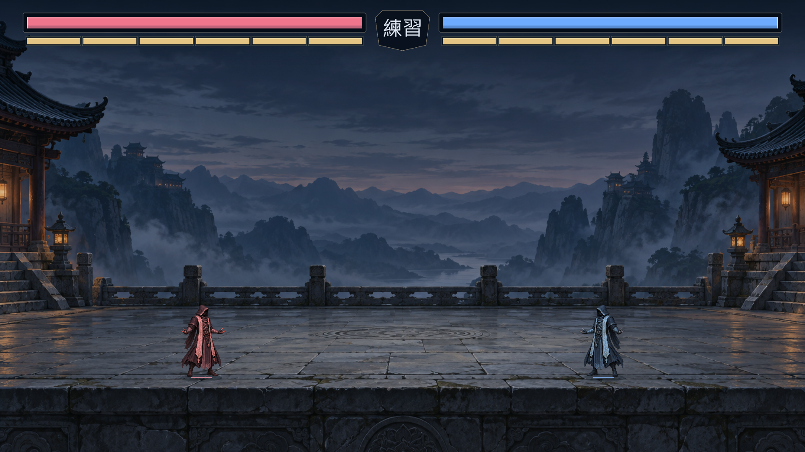

# GESTURE ARENA

目前版本包含紅藍法師、山間石台競技場、對稱血氣 HUD 與技能預警。網站建置、95 項單元測試、10 個瀏覽器流程及交付包解壓建置已驗證通過；詳細範圍見驗收報告。

依 `docs/gesture_workshop_final_spec.md` 製作，數值 numeric-v2-2026-10-08。

- **主機**：[gesture-arena/README.md](gesture-arena/README.md)。setup_windows.bat → start_windows.bat → http://localhost:3000 。
- **學員**：[gesture-player/README.md](gesture-player/README.md)。setup_windows.bat → run_windows.bat；正規化／KNN必做、濾波選做。
- **交付驗證**：[acceptance_report.md](acceptance_report.md)。分開記錄程式、自動測試、學員算法及活動設備。
- **獨立壓縮包**：delivery/。排除依賴、虛擬環境、個人資料與token，兩端各帶協定、fixtures和操作文件。

全部授權範圍為本機區網產品；沒有公開網站部署。官方Hand Landmarker模型已本機保存並驗SHA-256；真人算法保留指定教學TODO，不能把模拟連線當真人準確率。

維護工具：tools/generate_protocol.py生成三份一致協定；generate_golden.py生成固定特徵測試；numeric_audit.py独立數值核對；run_checks.py保存命令／exit／log；fresh_checks.py驗證獨立中文路徑；write_report.py彙整完成的證據；package_delivery.py產生獨立交付包。主機資料SQLite預設使用者私有目錄，不在原始碼。
